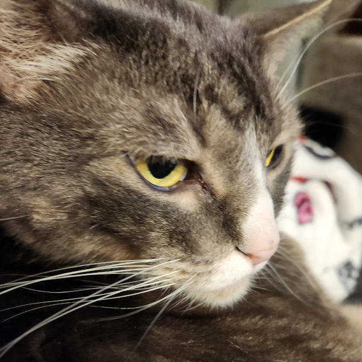
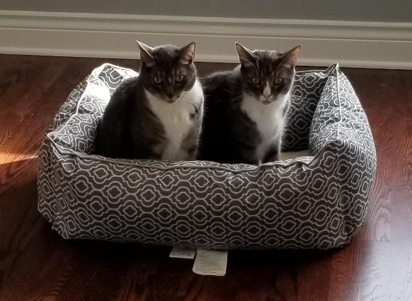
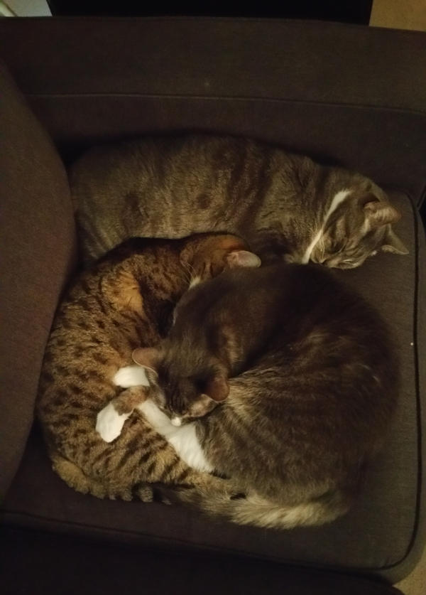
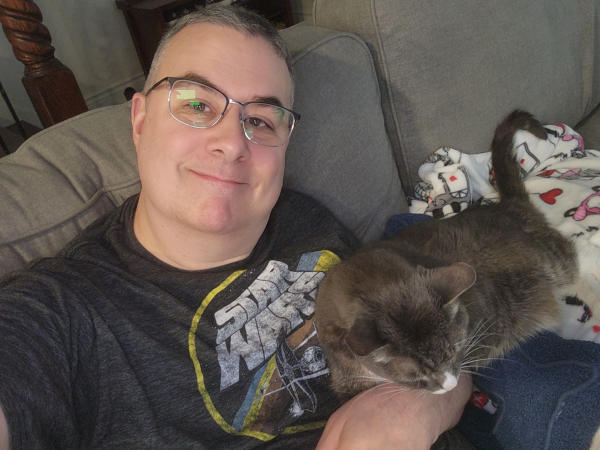

On Saturday, November 14, 2026, we had to say goodbye to our dear little man, Stan. He was 18-1/2 years old, which is a good long life for a cat.

We [brought Stan and his brother, Kai, home in July 2008]({{ site.url }}/archive/2008/07/06/welcome-kai-and-stanley.aspx) as kittens, brothers from the same litter. [Kai]({{ site.url }}/archive/2025/04/25/goodbye-kai) was always a little bigger than Stan, but Stan ran the show and we all knew it.

With our little girl cat, [Xev]({{ site.url }}/archive/2018/01/10/goodnight-princess-xev), we named them after one of our favorite shows, [Lexx](https://www.imdb.com/title/tt0115243/).

Originally his name was from the show - Stanley Tweedle. However over the course of his life he became His Royal Highness, the High Commander Staniel James Wonkfoot, Professor of Defense Against the Dark Arts.

Yeah, that's long. He earned it.

He was so demanding and persistent. An alpha, leading us around, herding us, and absolutely telling us about all of his problems. Very loudly. Repeatedly.

He lived through a remodel and having to move out of the house twice for our wood floors getting refinished. One of those times he lived with us in a pet-friendly long term stay hotel for a couple weeks. He was a total trooper. Never had a single accident.

As he got older, he decided one day he just wasn't going to go upstairs to where his food, water, and box were. Just, nope. We figured it out pretty quickly and moved things down for him. He mostly stayed downstairs after that, his arthritis giving him trouble.

He became my work buddy and I put a bed in my office by my desk so he could supervise. He liked to wake up, stretch, and then scratch on my mesh garbage can to get my attention, calling for pets. I'd pet him, maybe sing him a song, maybe carry him like a baby to our back glass door and sing him rockabye. He loved the attention.

He really loved his kisses. He'd do this thing where he'd walk across my chest so his front half was on me but his back half was on a pillow next to me, then he'd "slow flop" - the front half would flop down, then the back half would take a few seconds and follow. The head butts would commence and he wanted kisses on his head. Scratch the chin while you're doing that, too, human.

We found a lump in his tail and one on his side a couple years back. Cancer. He was already pretty old so we figured we'd let him live Best Cat Life instead of putting him through painful treatments that would make him miserable. He'd tell us when it was time to go.

I really wanted him to fall asleep and go peacefully, but instead we woke up on Saturday and he was having repeated seizures. The cancer had finally gotten to his brain. We took him to the vet and said goodbye.

This is the first time in... a long time. Over 20 years? That we haven't had a cat around here. I don't have anyone supervising my work efforts or yelling at me about how I'm not sitting down fast enough or giving the appropriate number of kisses. I don't have anyone slapping my leg to get my attention or grabbing my hand to pull it over and get pets. GTA6 comes out tomorrow. He won't be playing with me. I don't think I've ever played a GTA game without a Game Cat to keep me company. Stan was older than Phoenix. She's almost 16. She's never known a life without him. She's not getting her morning cuddles.

We're all pretty lonely without our little man. I just hope that, wherever he is, he's found Xev and Kai and he's having adventures with them now.

Goodbye, my good friend. We love you so much.

